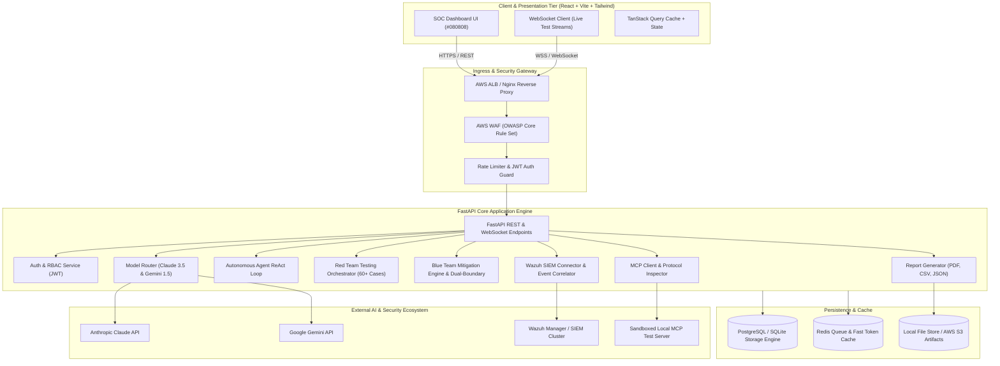
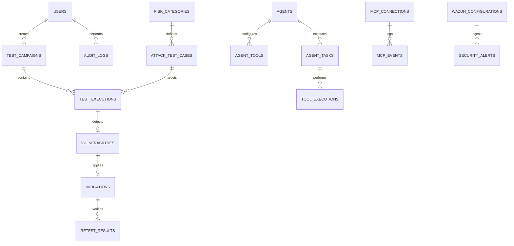

# SYSTEM ARCHITECTURE SPECIFICATION
## AI SECURITY FASTER — Automated AI Red-Teaming & Blue-Teaming Operations Center
**Architecture Standard:** Cloud-Native Enterprise & AWS DevOps / AML Reference Architecture  
**Target Environments:** Local Hybrid Developer Environment & Production AWS Cloud  

---

## 1. High-Level Architecture Overview

The **AI SECURITY FASTER** platform is built as a secure, reactive, microservice-ready modular monolith. It provides end-to-end orchestration of AI security testing, live agent evaluation, MCP protocol fuzzing, blue-team defense enforcement, and SIEM alerting.



---

## 2. Component Architecture & Data Flow

### 2.1 Frontend Architecture (React 19 + TypeScript + Vite)
- **Design System:** Deep Black `#080808`, Card `#171717`, Accent Glowing Orange `#FF8A00` / `#FFB347`, Success Emerald `#00C784`, Danger Ruby `#FF4545`.
- **Navigation Modules:**
  1. `Overview`: Master SOC Dashboard mirroring the reference design.
  2. `LLM Playground`: Frontier model chat interface with Synthetic RAG and live injection testing presets.
  3. `AI Agent Lab`: Autonomous tool-execution loop with Human-in-the-Loop (HITL) approval drawer.
  4. `Red Team Testing`: Automated campaign runner across 10 OWASP categories (60+ test cases).
  5. `OWASP Risk Matrix`: Interactive threat registry with filterable severity matrices and test trigger buttons.
  6. `MCP Security Lab`: Model Context Protocol sandbox, tool discovery, and blocked directory traversal PoC.
  7. `Blue Team Mitigations`: Guardrail toggles, dual-boundary prompt wrappers, PII/canary scanners.
  8. `Before / After Analysis`: Interactive Recharts analytics comparing risk reduction percentages.
  9. `Wazuh Integration`: Real-time SIEM health status, alert feeds, and AI incident mapping.
  10. `Reports & Audit Logs`: Multi-format report builder (JSON/CSV/PDF) and cryptographic audit ledger.
  11. `Settings`: Encrypted API key management (Anthropic & Gemini) and engine tuning.

### 2.2 Backend Architecture (FastAPI + SQLAlchemy + Pydantic v2)
The backend is organized into decoupled domain modules:
- `app/api/`: REST routing groups for auth, models, agent, tests, mitigations, mcp, wazuh, reports.
- `app/core/`: Security configs, JWT token handling, database session manager, logging.
- `app/models/`: SQLAlchemy 2.0 declarative database entities.
- `app/schemas/`: Pydantic models for request validation and response serialization.
- `app/integrations/`:
  - `claude_client.py`: Anthropic Messages API client with retry and token extraction.
  - `gemini_client.py`: Google GenAI client with safety setting overrides for red-team testing.
  - `fallback_simulator.py`: High-fidelity deterministic evaluation engine for offline QA.
- `app/agent/`:
  - `agent_runner.py`: ReAct loop orchestrating reasoning, tool selection, and state updates.
  - `tools/`: Sandboxed tools (`file_read`, `email_dispatch`, `http_request`, `mcp_call`).
  - `approval_gate.py`: Cryptographic token-based Human-in-the-Loop gateway.
- `app/redteam/`:
  - `risk_registry.py`: Formal mapping of OWASP LLM 2025/2026 and OWASP ASI 2026.
  - `test_suite.py`: 60+ attack test cases with inputs, expected vs actual behaviors, and scoring oracles.
  - `campaign_runner.py`: Asynchronous execution engine broadcasting events over WebSockets.
- `app/blueteam/`:
  - `defense_pipeline.py`: Active guardrail layers (Instruction Hierarchy, Canary Detection, Path Sanitizer, SSRF Guard).
  - `retest_oracle.py`: Empirical before/after comparison engine calculating delta risk scores.
- `app/mcp/`:
  - `mcp_server.py`: Lightweight standalone test server implementing the MCP JSON-RPC protocol.
  - `mcp_client.py`: Client querying tools, inspecting schemas, and running fuzzing probes.
- `app/wazuh/`:
  - `wazuh_client.py`: REST API integration communicating with Wazuh Manager (port 55000).
  - `rule_mapper.py`: Correlates AI incidents (e.g., `LLM01`, `ASI02`) with Wazuh Rule IDs (`100010`-`100025`).

---

## 3. Database Schema & Relational Entity Model



### Key Relational Entities:
1. `User`: `id`, `username`, `email`, `hashed_password`, `role`, `created_at`.
2. `RiskCategory`: `id` (e.g., `LLM01`), `name`, `framework` (OWASP LLM / ASI), `severity`, `description`.
3. `AttackTestCase`: `id`, `risk_id`, `name`, `attack_type`, `prompt_payload`, `expected_secure_behavior`, `severity`.
4. `TestCampaign`: `id`, `user_id`, `status`, `target_models`, `total_tests`, `vulnerabilities_found`, `started_at`, `completed_at`.
5. `TestExecution`: `id`, `campaign_id`, `test_case_id`, `model_name`, `prompt_used`, `raw_response`, `verdict` (PASS/FAIL), `latency_ms`, `tokens_used`, `evidence`.
6. `Mitigation`: `id`, `risk_id`, `defense_name`, `technique`, `config_params`, `active`.
7. `RetestResult`: `id`, `mitigation_id`, `test_execution_id`, `before_verdict`, `after_verdict`, `before_risk_score`, `after_risk_score`, `reduction_percentage`, `evidence`.
8. `AgentTask`: `id`, `task_input`, `status`, `reasoning_summary`, `created_at`.
9. `ToolExecution`: `id`, `task_id`, `tool_name`, `input_params`, `status` (PENDING_APPROVAL/APPROVED/REJECTED/EXECUTED/BLOCKED), `output_data`.
10. `MCPEvent`: `id`, `server_name`, `tool_invoked`, `payload`, `is_blocked`, `violation_reason`, `timestamp`.
11. `SecurityAlert`: `id`, `source` (Internal/Wazuh), `rule_id`, `risk_id`, `severity`, `details`, `timestamp`.
12. `AuditLog`: `id`, `timestamp`, `actor`, `action`, `resource`, `status`, `sha256_hash`.

---

## 4. AWS DevOps & Cloud Computing Architecture (AML & MLOps)

To deploy AI SECURITY FASTER at enterprise scale, the platform integrates with **Amazon Web Services (AWS)** using standard Infrastructure-as-Code (Terraform / AWS CDK) and Cloud-Native MLOps patterns:

```mermaid
flowchart LR
    subgraph AWS_Cloud ["AWS Cloud Infrastructure (us-east-1)"]
        subgraph Ingress ["Edge & Security"]
            CF[Amazon CloudFront]
            WAF[AWS WAF]
            ALB[Application Load Balancer]
        end

        subgraph Compute ["Containerized Microservices"]
            ECS[AWS ECS / Fargate Container Cluster]
            EKS[AWS EKS (K8s Autonomous Testing Pods)]
        end

        subgraph AML_MLOps ["AWS Advanced Machine Learning (AML)"]
            SageMaker[Amazon SageMaker Endpoints]
            Bedrock[Amazon Bedrock Guardrails]
            OpenSearch[Amazon OpenSearch Serverless (Vector Store)]
        end

        subgraph Storage_DB ["Persistence & Secrets"]
            RDS[(Amazon Aurora PostgreSQL)]
            ElastiCache[(Amazon ElastiCache Redis)]
            S3[(Amazon S3 Audit Bucket - Encrypted)]
            KMS[AWS KMS Customer Managed Keys]
            SM[AWS Secrets Manager]
        end

        subgraph Observability ["Telemetry & Security"]
            CW[Amazon CloudWatch Metrics & Logs]
            GuardDuty[AWS GuardDuty AI Protection]
            WazuhCluster[Wazuh Distributed Manager on EC2]
        end
    end

    CF --> WAF --> ALB --> ECS
    ECS --> RDS
    ECS --> ElastiCache
    ECS --> S3
    ECS --> SM
    ECS --> KMS
    ECS --> SageMaker
    ECS --> Bedrock
    ECS --> OpenSearch
    ECS --> CW
    ECS --> WazuhCluster
```

### AWS DevOps CI/CD Pipeline
1. **Source & Linting:** GitHub Repository triggers AWS CodePipeline / GitHub Actions on merge to `main`.
2. **Build & Security Scan:**
   - Docker image built with multi-stage builds.
   - Snyk / Trivy container vulnerability scan.
   - Bandit & Semgrep static application security testing (SAST).
3. **Registry:** Container images pushed to **Amazon ECR** with immutable tags.
4. **Continuous Deployment:**
   - AWS CodeDeploy performs blue/green rolling deployment to **AWS ECS Fargate**.
   - Automated database schema migrations run via AWS Lambda pre-traffic hook.
5. **AWS AML & Bedrock Guardrails Integration:**
   - Red team payloads evaluate both direct frontier models and **Amazon Bedrock Guardrails**.
   - Integration with **Amazon SageMaker Inference Endpoints** for hosting custom fine-tuned open-source evaluation models (Llama-3-70B-Instruct, Mistral-Large).
6. **Zero-Trust Security on AWS:**
   - AWS IAM Roles for Service Accounts (IRSA) enforcing least-privilege.
   - AWS KMS envelope encryption for all database records and S3 compliance reports.
   - AWS WAF protecting against DDoS, SQLi, and Layer 7 anomalies.

